# MindBalance — Database Design & Data Modeling Specification
**Document Code:** DBD-MB-V1.0  
**Database Engine:** Firebase Cloud Firestore  
**SDK / Admin Layer:** Firebase Admin SDK for Node.js with TypeScript Interfaces

---

## 1. Architectural Rationale & Data Strategy

Firebase Cloud Firestore was selected for MindBalance due to:
1. **Fully Managed & Serverless**: Zero infrastructure overhead — no database daemons, replica sets, or connection pool tuning. Ideal for rapid academic project delivery.
2. **Document-Model Flexibility**: Mood entries, assessments, and physical metrics naturally fit structured JSON documents with variable tags and metadata.
3. **Real-Time Capabilities**: Firestore's real-time listeners enable live dashboard updates without polling, enhancing the employee wellness experience.
4. **Firebase Auth Integration**: Seamless integration with Firebase Authentication for secure session management, eliminating the need for custom session-store logic.
5. **Security Rules**: Firestore Security Rules provide an additional server-side enforcement layer for RBAC and data isolation.
6. **Scalability**: Automatic horizontal scaling with no manual sharding or indexing configuration for basic queries.

---

## 2. Entity Relationship & Collection Diagram

```mermaid
erDiagram
    User ||--o{ MoodEntry : "logs"
    User ||--o{ StressAssessment : "completes"
    User ||--o{ PhysicalWellness : "records"
    User ||--o{ MindReliefSession : "conducts"
    User ||--o{ AiConversation : "owns"
    AiConversation ||--o{ AiMessage : "contains"
    User ||--o{ Notification : "receives"
    User ||--o{ WellnessEventRSVP : "registers"
    WellnessEvent ||--o{ WellnessEventRSVP : "has"
    User ||--o{ AuditLog : "initiates"

    User {
        string id PK "auto-generated doc ID"
        string email UK
        string passwordHash
        string firstName
        string lastName
        string role "EMPLOYEE | HR_MANAGER | ADMIN"
        string department
        object preferences
        timestamp createdAt
        timestamp updatedAt
    }

    MoodEntry {
        string id PK "auto-generated doc ID"
        string userId FK
        string date "YYYY-MM-DD for daily uniqueness"
        int valence "-5 to +5"
        string energy "LOW | MEDIUM | HIGH"
        int stressLevel "1 to 10"
        array tags
        string privateJournalEncrypted
        timestamp createdAt
    }

    StressAssessment {
        string id PK "auto-generated doc ID"
        string userId FK
        string assessmentType "PSS_4 | WHO_5"
        array answers
        int rawScore
        float normalizedScore "0 to 100"
        string severityBand "LOW | MODERATE | HIGH"
        timestamp createdAt
    }

    PhysicalWellness {
        string id PK "auto-generated doc ID"
        string userId FK
        string date "YYYY-MM-DD"
        int waterIntakeMl
        int waterGoalMl
        int postureBreaksCount
        int eyeBreaksCount
        int stepCount
        timestamp updatedAt
    }

    MindReliefSession {
        string id PK "auto-generated doc ID"
        string userId FK
        string exerciseType "BOX_BREATHING | FOUR_SEVEN_EIGHT | MEMORY_MATRIX | POMODORO"
        int durationSeconds
        int cyclesCompleted
        int score
        timestamp createdAt
    }

    AiConversation {
        string id PK "auto-generated doc ID"
        string userId FK
        string title
        boolean isArchived
        timestamp createdAt
        timestamp updatedAt
    }

    AiMessage {
        string id PK "auto-generated doc ID"
        string conversationId FK
        string userId FK
        string sender "USER | ASSISTANT | SYSTEM"
        string content
        boolean crisisFlagDetected
        timestamp createdAt
    }

    WellnessEvent {
        string id PK "auto-generated doc ID"
        string title
        string description
        string category "WEBINAR | WORKSHOP | MEDITATION | CHALLENGE"
        timestamp eventDate
        int durationMinutes
        string meetingUrl
        int capacity
        string hostId FK
        timestamp createdAt
    }

    WellnessEventRSVP {
        string id PK "auto-generated doc ID"
        string eventId FK
        string userId FK
        string status "CONFIRMED | CANCELLED"
        timestamp createdAt
    }

    ResourceArticle {
        string id PK "auto-generated doc ID"
        string title
        string slug UK
        string category "STRESS_RELIEF | ERGONOMICS | SLEEP | MINDFULNESS"
        string contentMarkdown
        int readTimeMinutes
        array tags
        string authorId FK
        timestamp publishedAt
    }

    AuditLog {
        string id PK "auto-generated doc ID"
        string actorId FK
        string actorEmail
        string role
        string action
        string targetResource
        string ipAddress
        string userAgent
        timestamp timestamp
    }
```



---

## 3. Firestore Collection Structure & TypeScript Interfaces

### 3.1. Collection Hierarchy

```
firestore-root/
├── users/                          # Top-level collection
│   └── {userId}/                   # Document per user
├── mood_entries/                   # Top-level collection
│   └── {entryId}/                  # Document per mood entry
├── stress_assessments/             # Top-level collection
│   └── {assessmentId}/
├── physical_wellness/              # Top-level collection
│   └── {recordId}/
├── mind_relief_sessions/           # Top-level collection
│   └── {sessionId}/
├── ai_conversations/               # Top-level collection
│   └── {conversationId}/
├── ai_messages/                    # Top-level collection
│   └── {messageId}/
├── wellness_events/                # Top-level collection
│   └── {eventId}/
├── wellness_event_rsvps/           # Top-level collection
│   └── {rsvpId}/
├── resource_articles/              # Top-level collection
│   └── {articleId}/
├── audit_logs/                     # Top-level collection
│   └── {logId}/
└── _health/                        # System health check collection
    └── ping
```

### 3.2. User Interface (`users`)
```typescript
export interface IUser {
  id: string;
  email: string;
  passwordHash: string;
  firstName: string;
  lastName: string;
  role: 'EMPLOYEE' | 'HR_MANAGER' | 'ADMIN';
  department: string;
  isActive: boolean;
  preferences: {
    hydrationGoalMl: number;       // default: 2000, min: 500, max: 6000
    reminderFrequencyMinutes: number; // default: 60, min: 15, max: 240
    prefersReducedMotion: boolean;  // default: false
    soundEnabled: boolean;         // default: true
  };
  lastLoginAt?: FirebaseFirestore.Timestamp;
  createdAt: FirebaseFirestore.Timestamp;
  updatedAt: FirebaseFirestore.Timestamp;
}
```

**Composite Indexes (configured in `firestore.indexes.json`):**
- `users`: `email` (ascending) — for unique email lookups
- `users`: `department` (ascending), `role` (ascending) — for departmental queries

### 3.3. MoodEntry Interface (`mood_entries`)
```typescript
export interface IMoodEntry {
  id: string;
  userId: string;
  date: string;                    // Normalized to "YYYY-MM-DD" for daily uniqueness
  valence: number;                 // -5 (Extremely Unpleasant) to +5 (Extremely Pleasant)
  energy: 'LOW' | 'MEDIUM' | 'HIGH';
  stressLevel: number;            // 1 (Relaxed) to 10 (Overwhelmed)
  tags: string[];                  // e.g. ["deadlines", "sleep", "meetings"]
  privateJournalEncrypted?: string;
  createdAt: FirebaseFirestore.Timestamp;
}
```

**Composite Indexes:**
- `mood_entries`: `userId` (asc), `date` (desc) — for per-user daily lookups (enforced unique via doc ID = `${userId}_${date}`)
- `mood_entries`: `date` (desc), `stressLevel` (asc) — for anonymized aggregations

### 3.4. StressAssessment Interface (`stress_assessments`)
```typescript
export interface IStressAssessment {
  id: string;
  userId: string;
  assessmentType: 'PSS_4' | 'WHO_5';
  answers: number[];
  rawScore: number;
  normalizedScore: number;         // 0 - 100
  severityBand: 'LOW' | 'MODERATE' | 'HIGH';
  createdAt: FirebaseFirestore.Timestamp;
}
```

**Composite Indexes:**
- `stress_assessments`: `userId` (asc), `createdAt` (desc)

### 3.5. PhysicalWellness Interface (`physical_wellness`)
```typescript
export interface IPhysicalWellness {
  id: string;
  userId: string;
  date: string;                    // Normalized to "YYYY-MM-DD"
  waterIntakeMl: number;           // default: 0
  waterGoalMl: number;            // default: 2000
  postureBreaksCount: number;      // default: 0
  eyeBreaksCount: number;         // default: 0
  stepCount: number;              // default: 0
  updatedAt: FirebaseFirestore.Timestamp;
}
```

**Composite Indexes:**
- `physical_wellness`: `userId` (asc), `date` (asc) — unique via doc ID = `${userId}_${date}`

### 3.6. MindReliefSession Interface (`mind_relief_sessions`)
```typescript
export interface IMindReliefSession {
  id: string;
  userId: string;
  exerciseType: 'BOX_BREATHING' | 'FOUR_SEVEN_EIGHT' | 'MEMORY_MATRIX' | 'POMODORO';
  durationSeconds: number;
  cyclesCompleted?: number;
  score?: number;
  createdAt: FirebaseFirestore.Timestamp;
}
```

**Composite Indexes:**
- `mind_relief_sessions`: `userId` (asc), `createdAt` (desc)

### 3.7. AI Assistant Interfaces (`ai_conversations` & `ai_messages`)
```typescript
export interface IAiConversation {
  id: string;
  userId: string;
  title: string;                   // default: "Mindful Reflection"
  isArchived: boolean;             // default: false
  createdAt: FirebaseFirestore.Timestamp;
  updatedAt: FirebaseFirestore.Timestamp;
}

export interface IAiMessage {
  id: string;
  conversationId: string;
  userId: string;                  // For strict owner querying
  sender: 'USER' | 'ASSISTANT' | 'SYSTEM';
  content: string;
  crisisFlagDetected: boolean;     // default: false
  createdAt: FirebaseFirestore.Timestamp;
}
```

**Composite Indexes:**
- `ai_conversations`: `userId` (asc), `createdAt` (desc)
- `ai_messages`: `conversationId` (asc), `createdAt` (asc)

---

## 4. Privacy-Preserving HR Aggregation Logic

Below is the authoritative server-side aggregation logic employed by the backend to extract departmental stress distributions while strictly enforcing $k$-anonymity ($k=7$):

```typescript
// Function in AnalyticsService: getDepartmentStressTelemetry(departmentName, startDate, endDate)
import { getDb } from '../config/database.js';
import { K_ANONYMITY_THRESHOLD } from '../config/constants.js';

async function getDepartmentStressTelemetry(
  departmentName: string,
  startDate: Date,
  endDate: Date
) {
  const db = getDb();

  // Step 1: Find active employees in the target department
  const usersSnapshot = await db.collection('users')
    .where('department', '==', departmentName)
    .where('isActive', '==', true)
    .where('role', '==', 'EMPLOYEE')
    .select()  // Only fetch document IDs, no field data needed
    .get();

  const userIds = usersSnapshot.docs.map(doc => doc.id);

  if (userIds.length === 0) {
    return { activeRespondentCount: 0, isMasked: true, avgStress: null, avgValence: null };
  }

  // Step 2: Query mood entries for these users within the timeframe
  // Firestore 'in' queries support up to 30 items; batch if needed
  const allStressScores: number[] = [];
  const allValenceScores: number[] = [];
  const respondentSet = new Set<string>();

  for (let i = 0; i < userIds.length; i += 30) {
    const batch = userIds.slice(i, i + 30);
    const entriesSnapshot = await db.collection('mood_entries')
      .where('userId', 'in', batch)
      .where('createdAt', '>=', startDate)
      .where('createdAt', '<=', endDate)
      .select('userId', 'stressLevel', 'valence')
      .get();

    for (const doc of entriesSnapshot.docs) {
      const data = doc.data();
      respondentSet.add(data.userId);
      allStressScores.push(data.stressLevel);
      allValenceScores.push(data.valence);
    }
  }

  const activeRespondentCount = respondentSet.size;

  // Step 3: Check k-anonymity gate
  if (activeRespondentCount < K_ANONYMITY_THRESHOLD) {
    return { activeRespondentCount, isMasked: true, avgStress: null, avgValence: null };
  }

  // Step 4: Compute averages only IF sample size >= K_ANONYMITY_THRESHOLD
  const avgStress = allStressScores.reduce((a, b) => a + b, 0) / allStressScores.length;
  const avgValence = allValenceScores.reduce((a, b) => a + b, 0) / allValenceScores.length;

  return { activeRespondentCount, isMasked: false, avgStress, avgValence };
}
```

---

## 5. Employee Data Erasure & Purge Strategy

In compliance with the "Right to Erasure" and employee autonomy:
- A user can trigger `DELETE /api/v1/wellness/purge-personal-data`.
- Using a Firestore **batched write** (atomic operation, max 500 operations per batch):
  1. Deletes all `mood_entries` documents matching `userId`.
  2. Deletes all `stress_assessments` documents matching `userId`.
  3. Deletes all `physical_wellness` documents matching `userId`.
  4. Deletes all `mind_relief_sessions` documents matching `userId`.
  5. Cascades deletion of all `ai_messages` and `ai_conversations` documents matching `userId`.
- The user account remains active, but historical mental health telemetry is permanently wiped.

```typescript
async function purgeUserWellnessData(userId: string): Promise<void> {
  const db = getDb();
  const collections = [
    'mood_entries',
    'stress_assessments',
    'physical_wellness',
    'mind_relief_sessions',
    'ai_messages',
    'ai_conversations'
  ];

  for (const collectionName of collections) {
    const snapshot = await db.collection(collectionName)
      .where('userId', '==', userId)
      .get();

    // Firestore batches support max 500 operations
    const batches: FirebaseFirestore.WriteBatch[] = [];
    let currentBatch = db.batch();
    let operationCount = 0;

    for (const doc of snapshot.docs) {
      currentBatch.delete(doc.ref);
      operationCount++;

      if (operationCount === 500) {
        batches.push(currentBatch);
        currentBatch = db.batch();
        operationCount = 0;
      }
    }

    if (operationCount > 0) {
      batches.push(currentBatch);
    }

    await Promise.all(batches.map(batch => batch.commit()));
  }
}
```

---

## 6. Firestore Indexes Configuration

Create a `firestore.indexes.json` in the project root for deploying composite indexes:

```json
{
  "indexes": [
    {
      "collectionGroup": "mood_entries",
      "queryScope": "COLLECTION",
      "fields": [
        { "fieldPath": "userId", "order": "ASCENDING" },
        { "fieldPath": "date", "order": "DESCENDING" }
      ]
    },
    {
      "collectionGroup": "mood_entries",
      "queryScope": "COLLECTION",
      "fields": [
        { "fieldPath": "userId", "order": "ASCENDING" },
        { "fieldPath": "createdAt", "order": "DESCENDING" }
      ]
    },
    {
      "collectionGroup": "stress_assessments",
      "queryScope": "COLLECTION",
      "fields": [
        { "fieldPath": "userId", "order": "ASCENDING" },
        { "fieldPath": "createdAt", "order": "DESCENDING" }
      ]
    },
    {
      "collectionGroup": "physical_wellness",
      "queryScope": "COLLECTION",
      "fields": [
        { "fieldPath": "userId", "order": "ASCENDING" },
        { "fieldPath": "date", "order": "ASCENDING" }
      ]
    },
    {
      "collectionGroup": "mind_relief_sessions",
      "queryScope": "COLLECTION",
      "fields": [
        { "fieldPath": "userId", "order": "ASCENDING" },
        { "fieldPath": "createdAt", "order": "DESCENDING" }
      ]
    },
    {
      "collectionGroup": "ai_messages",
      "queryScope": "COLLECTION",
      "fields": [
        { "fieldPath": "conversationId", "order": "ASCENDING" },
        { "fieldPath": "createdAt", "order": "ASCENDING" }
      ]
    },
    {
      "collectionGroup": "ai_conversations",
      "queryScope": "COLLECTION",
      "fields": [
        { "fieldPath": "userId", "order": "ASCENDING" },
        { "fieldPath": "createdAt", "order": "DESCENDING" }
      ]
    }
  ],
  "fieldOverrides": []
}
```
