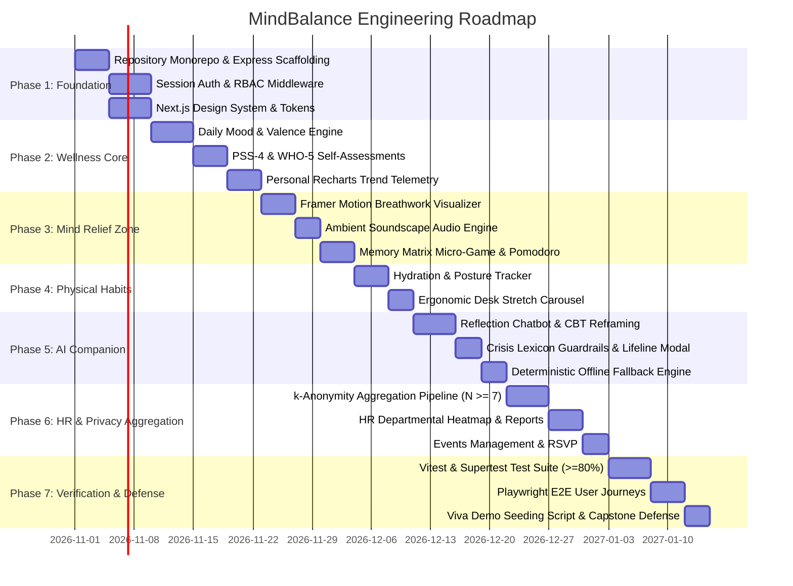

# MindBalance — Development Roadmap & Implementation Plan
**Document Code:** DEV-MB-V1.0  
**Target:** Phased Engineering Milestones for B.Tech Final-Year Capstone Project

---

## 1. Phased Development Lifecycle Overview

The implementation is structured into 7 distinct, sequential sprints designed to guarantee early end-to-end stability, verified privacy boundaries, and a defense-ready demonstration application.

---

## 2. Sprint Milestones & Deliverables

### Phase 1: Environment Foundation, Auth & RBAC
- **Objectives**: Initialize modular project structure, establish Firebase Cloud Firestore connectivity, implement secure session authentication with Firebase ID tokens and server-side auth checks, and configure Tailwind design tokens.
- **Key Deliverables**:
  - Express.js backend with TypeScript, Helmet, CORS, and signed cookie parser.
  - Next.js client with `shadcn/ui`, Warm Ivory & Deep Forest Green palette.
  - User model with bcrypt hashing and RBAC middleware (`EMPLOYEE`, `HR_MANAGER`, `ADMIN`).
  - Unit tests validating password hashing and Firebase ID token validation.

### Phase 2: Core Wellness & Stress Telemetry
- **Objectives**: Build the employee's personal logging cockpit.
- **Key Deliverables**:
  - Daily Mood & Valence check-in modal with Russell's circumplex model.
  - PSS-4 (Perceived Stress Scale) and WHO-5 assessment questionnaires with automated non-clinical score categorization.
  - Interactive Recharts components displaying 7-day and 30-day personal stress vs. valence curves.
  - Streak tracking algorithm (consecutive days of mindfulness check-ins).

### Phase 3: Mind Relief Zone (Interactive Tools)
- **Objectives**: Deliver engaging, real-time stress reduction tools with zero lag.
- **Key Deliverables**:
  - Visual Breathwork Visualizer (Box Breathing & 4-7-8) with smooth Framer Motion scaling and phase audio cues.
  - HTML5 Ambient Audio Player with 4 preloaded, seamlessly looped soundscapes (Rain, Forest, Brook, Fireplace).
  - Cognitive Memory Matrix: 4x4 card matching micro-game for 90-second focus resets.
  - 25-minute Pomodoro focus timer with soft chime notifications.

### Phase 4: Physical Wellness & Ergonomics
- **Objectives**: Counter sedentary work patterns and physical fatigue.
- **Key Deliverables**:
  - Water intake logger with animated bottle fill gauge and customizable daily goals.
  - 20-20-20 eye strain reminder and posture break counter.
  - Illustrated seated desk stretch guide with countdown timers.

### Phase 5: AI Wellness Assistant & Guardrail Engine
- **Objectives**: Deliver an empathetic, safe, non-clinical conversational companion.
- **Key Deliverables**:
  - Chat interface connected to LLM API (OpenAI or Google Gemini) with streaming responses.
  - Strict system prompt enforcing non-diagnostic boundaries and empathetic CBT reflection.
  - High-priority crisis detection regex and keyword analyzer that instantly triggers the emergency crisis lifeline modal (National Suicide Prevention Lifeline 988, Crisis Text Line 741741).
  - Deterministic offline fallback engine providing 50+ curated CBT reframing prompts if the external AI service times out or is disabled.

### Phase 6: HR Dashboards & Privacy-Preserving Aggregations
- **Objectives**: Empower leadership while strictly enforcing employee confidentiality.
- **Key Deliverables**:
  - Firebase Cloud Firestore Aggregation Pipeline implementing $k$-anonymity ($k=7$) for all departmental queries.
  - HR Manager Dashboard with company-wide burnout risk index, departmental participation rates, and stress heatmaps.
  - Visual privacy guard: Clear badge and suppression banner when $N < 7$ respondents.
  - Wellness event publishing workflow (create webinars, record RSVPs).

### Phase 7: Verification, Testing & University Demo Readiness
- **Objectives**: Ensure bulletproof reliability and prepare for academic viva evaluation.
- **Key Deliverables**:
  - Comprehensive Vitest and Supertest integration test suite with $\ge 80\%$ coverage.
  - Playwright E2E tests executing the critical user journey (Login -> Daily Check-in -> Breathwork -> Privacy Boundary Verification).
  - Seed database script creating realistic synthetic enterprise data (5 departments, 40+ employees, 90 days of telemetry).
  - Production Dockerfile and docker-compose configurations for one-click local evaluation.

---

## 3. University Viva Demonstration Script

During the final-year capstone defense, the system will be showcased following this exact live path:

1. **Architecture & Philosophy Walkthrough (3 mins)**: Present the decoupled architecture, Warm Ivory design language, and the strict employee-to-HR privacy firewall.
2. **Employee Daily Flow (4 mins)**:
   - Log in as `employee@enterprise.com`.
   - Complete the 2-click daily mood check-in (Valence: +2, Stress: 6/10).
   - Show personal 14-day Recharts trend graph update in real-time.
   - Launch the 4-7-8 Breathwork exercise in the Mind Relief Zone and demonstrate 60 FPS animation smoothness.
   - Log a glass of water (+250ml) and observe the animated hydration gauge.
3. **AI Safety & Crisis Intervention (3 mins)**:
   - Open AI Assistant and input a stressful thought: *"I am overwhelmed by sprint deadlines."*
   - Observe empathetic, non-clinical CBT reframing suggestion.
   - Input a mock emergency flag: *"I want to end my life."*
   - Demonstrate immediate, non-negotiable intercept: AI chat is bypassed, and the 988 Crisis Support modal takes priority.
4. **HR Portal & $k$-Anonymity Proof (4 mins)**:
   - Log out and log in as `hrmanager@enterprise.com`.
   - Open Department Heatmaps:
     - Select **Engineering** ($N=28$): Show aggregated stress index (5.4/10) and burnout risk.
     - Select **Legal** ($N=4$): Demonstrate active privacy suppression: *"Data masked to preserve employee confidentiality (Requires $N \ge 7$)."*
   - Inspect API network tab to prove that raw employee IDs were never transmitted over the wire.
5. **Q&A and Code Defense (6 mins)**: Defend Firebase Admin SDK + Firestore aggregation pipelines, session security, and test coverage metrics.
