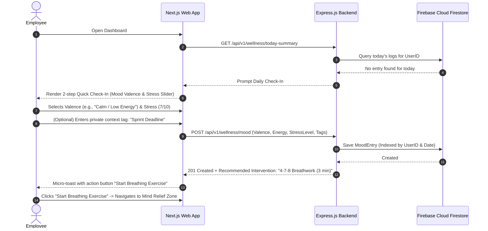
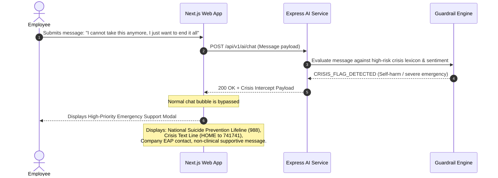
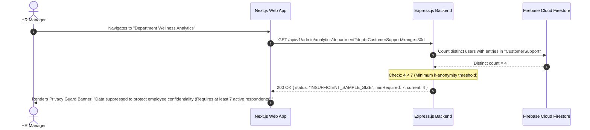
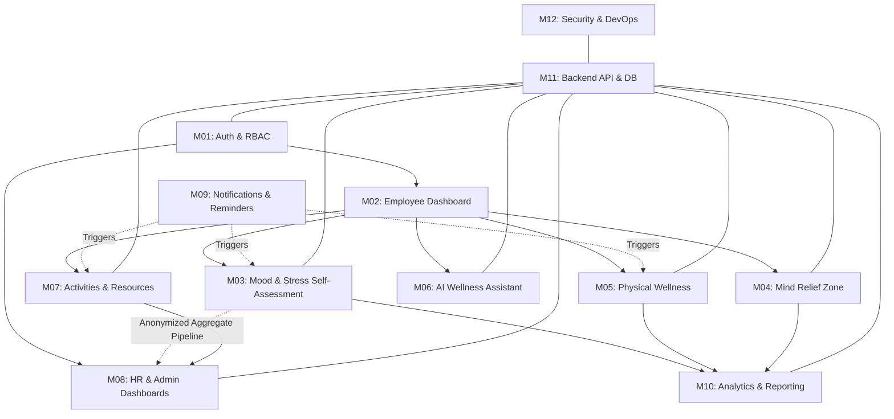

# MindBalance — Functional Requirements Specification
**Document Code:** FRS-MB-V1.0  
**Target:** Full-Stack Enterprise Workforce Well-being System

---

## 1. User Roles & Permission Matrix (RBAC)

MindBalance enforces strict Role-Based Access Control (RBAC) across three primary actors:
- **`EMPLOYEE`**: Individual contributors and team members accessing personal tools.
- **`HR_MANAGER`**: People Operations leaders viewing anonymized aggregates and managing events.
- **`ADMIN`**: Technical and system administrators managing tenant accounts, policies, and audit logs.

### 1.1. Permission Matrix

| Feature / Capability | Employee | HR Manager | Admin | Notes / Constraints |
|---|:---:|:---:|:---:|---|
| **User Sign-up / Login / Session Revoke** | ✅ | ✅ | ✅ | Standard session authentication |
| **Personal Mood & Valence Logging** | ✅ | ❌ | ❌ | Strictly private to individual user |
| **Self-Administered Assessments (PSS-4, WHO-5)** | ✅ | ❌ | ❌ | Results viewable only by employee |
| **Personal Assessment History & Trends** | ✅ | ❌ | ❌ | Individual longitudinal telemetry |
| **Mind Relief Zone (Breathing, Games, Audio)** | ✅ | ✅ | ✅ | Accessible to all logged-in users |
| **Physical Wellness Tracking (Hydration, Breaks)** | ✅ | ❌ | ❌ | Personal habit counters |
| **AI Wellness Assistant Conversations** | ✅ | ❌ | ❌ | Fully isolated, confidential chats |
| **Event / Webinar Browsing & RSVP** | ✅ | ✅ | ✅ | Individual registration |
| **Event Creation, Modification & Attendance** | ❌ | ✅ | ✅ | HR and Admin operational control |
| **Resource Library Consumption** | ✅ | ✅ | ✅ | Curated guides and audio sessions |
| **Resource Article Creation / Management** | ❌ | ✅ | ✅ | HR publishing workflow |
| **Departmental Stress Heatmaps ($N \ge 7$)** | ❌ | ✅ | ✅ | Enforces $k$-anonymity threshold |
| **Organization Burnout Risk Index** | ❌ | ✅ | ✅ | Aggregated score across teams |
| **Download Anonymized Executive Reports** | ❌ | ✅ | ✅ | PDF/CSV aggregate metrics |
| **Individual Journal / Note Inspection** | ❌ | ❌ | ❌ | **NEVER ALLOWED** by any role |
| **User & Department Provisioning** | ❌ | ❌ | ✅ | Admin-only tenant management |
| **System Audit Logs & Security Metrics** | ❌ | ❌ | ✅ | Admin-only compliance viewing |

---

## 2. Core User Workflows

### 2.1. Workflow 1: Daily Employee Check-In & Micro-Intervention

### 2.2. Workflow 2: Safety Filter & Crisis Triage Workflow

### 2.3. Workflow 3: HR Departmental Pulse & $k$-Anonymity Verification

---

## 3. Module-by-Module Functional Specifications

### Module 01: Authentication & Role-Based Access Control
- **FR-1.1**: Email & password authentication with bcrypt (min salt rounds 12) or argon2id.
- **FR-1.2**: Session persistence via HTTP-only, `SameSite=Strict`, `Secure` cookies.
- **FR-1.3**: Session invalidation on explicit logout or inactivity timeout (configurable, default 7 days).
- **FR-1.4**: Automatic route guarding on both Next.js middleware and Express API routes.
- **FR-1.5**: Password complexity enforcement: min 8 characters, at least 1 uppercase, 1 numeric, 1 special character.

### Module 02: Employee Wellness Dashboard
- **FR-2.1**: Real-time personalized greeting showing current date, motivational prompt, and active streak count.
- **FR-2.2**: Daily Status Snapshot: Highlights today’s mood status, water intake progress, and remaining focus time.
- **FR-2.3**: Longitudinal 7-day mini-chart displaying personal stress and energy trends.
- **FR-2.4**: "Quick Relief" action panel: One-click jump to Guided Breathing, Desk Stretches, or AI Reflection.
- **FR-2.5**: Upcoming scheduled wellness webinars and company challenges summary.

### Module 03: Mood Tracking & Stress Self-Assessments
- **FR-3.1**: **Daily Mood Check-In**: 
  - Russell's Circumplex Model adaptation: Valence (-5 to +5) and Energy/Arousal (Low, Medium, High).
  - Contextual tags (e.g., `Workload`, `Meetings`, `Sleep`, `Physical Health`, `Team`).
  - Optional private journal reflection (strictly encrypted/private).
- **FR-3.2**: **Standardized Clinical-Lite Self-Assessments**:
  - **PSS-4 (Perceived Stress Scale)**: 4 standardized questions on a 0-4 Likert scale. Calculates aggregate score (0-16) categorized as Low (0-5), Moderate (6-10), High (11-16).
  - **WHO-5 Well-Being Index**: 5 positive mood questions (0-5). Score converted to 0-100% scale.
- **FR-3.3**: Clear non-clinical disclaimer shown prior to and following every assessment.
- **FR-3.4**: Historical comparison view showing user their monthly assessment trajectory.

### Module 04: Mind Relief Zone
- **FR-4.1**: **Visual Guided Breathwork**:
  - Box Breathing (4s Inhale, 4s Hold, 4s Exhale, 4s Hold).
  - 4-7-8 Relaxing Breath (4s Inhale, 7s Hold, 8s Exhale).
  - Animated SVG/Canvas circle expanding/contracting with smooth timing and haptic/audio cues.
  - Cycle counter and session duration tracker (default 2 to 5 minutes).
- **FR-4.2**: **Ambient Acoustic Soundscapes**:
  - HTML5 audio engine with seamless looping and volume sliders.
  - Curated tracks: Rain on Leaves, Forest Brook, Deep Binaural White Noise, Soft Fireplace.
- **FR-4.3**: **Cognitive Decompression: Memory Matrix**:
  - Lightweight 4x4 card-matching memory micro-game designed for 90-second cognitive reset.
  - Tracks flips and completion time; rewards with mindful affirmation upon completion.
- **FR-4.4**: **Focus & Pomodoro Challenge**:
  - 25-minute focus intervals + 5-minute restorative breaks.
  - Ambient progress indicator and optional browser chime.

### Module 05: Physical Wellness Tracking
- **FR-5.1**: **Hydration Tracker**:
  - Target daily goal (default: 2,000 ml).
  - Increment buttons (+250 ml glass, +500 ml bottle).
  - Visual water level indicator filling with smooth Framer Motion spring physics.
- **FR-5.2**: **Ergonomic Posture & Eye-Break Reminders**:
  - 20-20-20 rule timer (Every 20 mins, look 20 feet away for 20 seconds).
  - Desk stretch carousel: 6 illustrated, step-by-step seated stretches (Neck roll, Wrist stretch, Seated twist).
- **FR-5.3**: Manual daily step/movement input log (e.g., 6,500 / 10,000 steps).

### Module 06: AI-Powered Wellness Assistant
- **FR-6.1**: Conversational interface optimized for non-clinical stress management and reflection.
- **FR-6.2**: **Cognitive Reframing Engine**: User enters a catastrophic or stressful thought; assistant helps deconstruct it into balanced perspectives using Cognitive Behavioral Therapy (CBT) reflection principles.
- **FR-6.3**: Strict System Guardrails:
  - Explicitly states: *"I am an AI wellness companion, not a licensed medical professional."*
  - Refuses medical diagnosis or prescription inquiries.
- **FR-6.4**: **Emergency Triage**: Regex and semantic checks for self-harm/suicidal ideation; immediately overrides conversation with crisis resources.
- **FR-6.5**: Ephemeral & Private Storage: Users can clear chat history with one click. Chats are never accessible to HR or administrators.

### Module 07: Wellness Activities, Events & Resources
- **FR-7.1**: Event directory: Webinars (e.g., "Navigating Imposter Syndrome"), group meditation sessions, mindfulness challenges.
- **FR-7.2**: One-click RSVP with automatic calendar (.ics) download.
- **FR-7.3**: Resource Library: Categorized articles, quick reads (< 5 mins), and stress management tips.
- **FR-7.4**: HR capability to publish, edit, and archive events and resource articles.

### Module 08: HR & Administrator Dashboards
- **FR-8.1**: Departmental overview showing aggregate participation rate and stress levels.
- **FR-8.2**: **$k$-Anonymity Gatekeeper**: Any department with fewer than 7 respondents has its raw metrics masked.
- **FR-8.3**: Organizational Burnout Risk Index: Calculated via anonymous aggregate formula blending high-stress frequency, low-valence clusters, and voluntary check-in dropoffs.
- **FR-8.4**: Wellness Program ROI Telemetry: Attendance at workshops vs. aggregate stress changes over 30/60/90 days.

### Module 09: Notifications & Reminders
- **FR-9.1**: In-app notification center (bell icon with unread badge).
- **FR-9.2**: Web Push Notification toggle (using Service Worker Notification API).
- **FR-9.3**: User preference panel: Configure reminder intervals for Hydration (every 60m), Posture (every 45m), and Daily Reflection (at 4:30 PM).

### Module 10: Analytics & Reporting
- **FR-10.1**: Interactive Recharts components: Multi-line trend analysis, dual-axis stress vs. hydration correlation, and mood distribution bar charts.
- **FR-10.2**: Date range selectors: 7 days, 30 days, 90 days, Custom Range.
- **FR-10.3**: Export capability: Employees can download their personal wellness summary in JSON/PDF; HR can download anonymized aggregate reports in PDF/CSV.

### Module 11: Backend APIs & Database Management
- **FR-11.1**: Centralized Express router mounted under `/api/v1/`.
- **FR-11.2**: Zod validation middleware parsing `req.body`, `req.query`, and `req.params`.
- **FR-11.3**: Robust Firebase Admin SDK + Firestore schemas with data sanitization, timestamps, and optimal compound indexes.
- **FR-11.4**: Centralized async error-handling middleware returning standardized JSON error payloads.

### Module 12: Security, Testing & Deployment
- **FR-12.1**: Rate limiting (Express-rate-limit): 100 requests per 15 minutes per IP on general endpoints, 10 requests per 15 minutes on auth/AI endpoints.
- **FR-12.2**: Cross-Site Scripting (XSS) and Content Security Policy (CSP) protections via Helmet.
- **FR-12.3**: Automated test suites in Vitest, Supertest, and Playwright with minimum 80% code coverage.
- **FR-12.4**: Production Dockerfile and docker-compose configurations for repeatable local and cloud deployments.

---

## 4. Module Dependencies & Interaction Graph

---

## 5. Acceptance Criteria Checklist

- [ ] **AC-01 (Auth)**: Unauthenticated requests to `/api/v1/wellness/*` or `/api/v1/admin/*` receive HTTP 401 Unauthorized.
- [ ] **AC-02 (RBAC)**: An `EMPLOYEE` session attempting to hit `/api/v1/admin/*` receives HTTP 403 Forbidden.
- [ ] **AC-03 (Privacy)**: No database query exists that links an individual employee ID to the HR analytics dashboard response.
- [ ] **AC-04 (Anonymity)**: Any department query with $N < 7$ returns `status: "INSUFFICIENT_SAMPLE_SIZE"` and zeroes out metrics.
- [ ] **AC-05 (Safety)**: Inputting self-harm keywords to the AI assistant returns an immediate crisis lifeline modal within 1 second.
- [ ] **AC-06 (Stress Engine)**: PSS-4 assessment calculates accurate scores (0-16) and tags severity tiers without clinical diagnostic terms.
- [ ] **AC-07 (Breathwork)**: Breathwork visualizer completes exact 16-second box cycles with smooth Framer Motion transitions.
