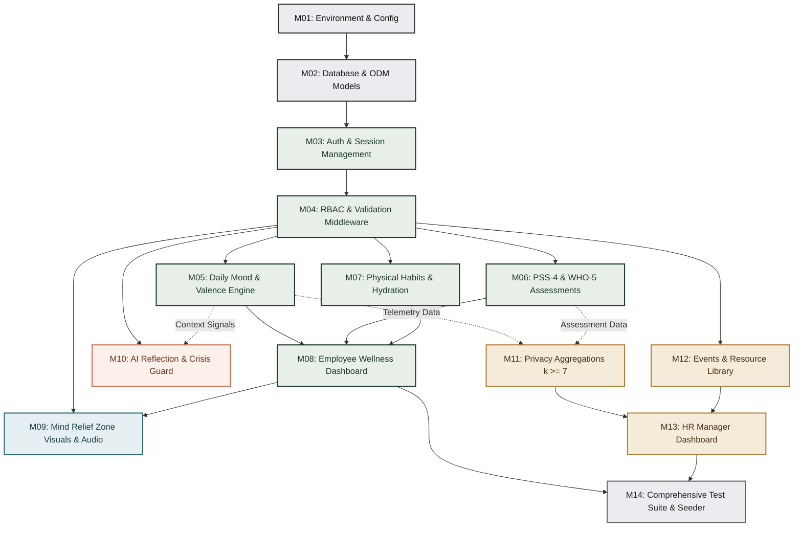

# MindBalance — Module Dependencies & Implementation Order
**Document Code:** MD-MB-V1.0  
**Focus:** Inter-Module Dependency Mapping & Optimal Critical Path Implementation Order

---

## 1. Module Dependency Matrix & Graph

Each module in MindBalance is designed with high cohesion and low coupling. However, foundational services (Authentication, Security Ingress, and Database Models) form prerequisites for higher-level interactive and analytical modules.

---

## 2. Dependency Breakdown by Functional Group

### Group A: Infrastructure & Security Foundation (Strict Prerequisites)
1. **Module 01: Environment Configuration (`config/env.ts`)**:
   - *Dependencies*: None.
   - *Downstream Consumers*: All backend services.
   - *Role*: Validates `FIREBASE_PROJECT_ID`, `FIREBASE_CLIENT_EMAIL`, `FIREBASE_PRIVATE_KEY`, `PORT`, `SESSION_SECRET`, and `CLIENT_ORIGIN` before any connections are attempted.
2. **Module 02: Database Connection & Core Models (`config/database.ts`, `models/user.model.ts`)**:
   - *Dependencies*: Module 01.
   - *Downstream Consumers*: Auth, Session, and all business services.
3. **Module 03: Authentication & Session Store (`services/auth.service.ts`, `config/session.ts`)**:
   - *Dependencies*: Modules 01, 02.
   - *Downstream Consumers*: All authenticated endpoints.
   - *Role*: Manages bcrypt password verification, Firebase Auth and Firestore-backed user records, and HTTP-only cookie serialization.
4. **Module 04: RBAC & Validation Middleware (`middleware/auth.ts`, `middleware/rbac.ts`, `middleware/validate.ts`)**:
   - *Dependencies*: Module 03.
   - *Downstream Consumers*: All API routers.
   - *Role*: Intercepts incoming requests, verifies session validity, checks user role (`EMPLOYEE`, `HR_MANAGER`, `ADMIN`), and executes Zod schema validation.

### Group B: Employee Wellness Core (Personal Cockpit)
5. **Module 05: Daily Mood & Valence Engine (`services/wellness.service.ts`)**:
   - *Dependencies*: Module 04.
   - *Role*: Records daily mood, valence (-5 to +5), energy level, stress level, and calculates streak continuity. Applies AES-256-GCM encryption to optional private notes.
6. **Module 06: Stress Assessments (`services/assessment.service.ts`)**:
   - *Dependencies*: Module 04.
   - *Role*: Ingests raw Likert responses for PSS-4 and WHO-5, inverts positive items, computes normalized scores, and classifies severity bands with non-clinical guidance.
7. **Module 07: Physical Habits & Hydration (`services/physical.service.ts`)**:
   - *Dependencies*: Module 04.
   - *Role*: Tracks daily water intake increments (+250ml), checks goal thresholds, and logs posture and eye-strain micro-breaks.
8. **Module 08: Employee Wellness Dashboard (`client/src/app/(dashboard)/dashboard`)**:
   - *Dependencies*: Modules 05, 06, 07.
   - *Role*: Aggregates today's summary, streak count, quick micro-intervention triggers, and Recharts personal 14-day trajectory.

### Group C: Interactive Mind Relief & AI Companion
9. **Module 09: Mind Relief Zone (`client/src/app/(dashboard)/relief`, `services/relief.service.ts`)**:
   - *Dependencies*: Module 04 (Client-side rendering supported by backend session logging).
   - *Role*: Hosts Framer Motion Box & 4-7-8 Breathwork, HTML5 Ambient Soundscapes (Rain, Forest, Brook), Memory Matrix micro-game, and Pomodoro timer.
10. **Module 10: AI Reflection Assistant & Safety Triage (`services/ai.service.ts`, `services/crisisGuard.service.ts`)**:
    - *Dependencies*: Module 04.
    - *Role*: Provides empathetic conversational reflection with CBT reframing; incorporates strict crisis lexicon detection that bypasses AI and immediately displays emergency crisis lifelines (988 Lifeline).

### Group D: Organizational Insights & Administration
11. **Module 11: Privacy-Preserving Aggregations (`services/analytics.service.ts`)**:
    - *Dependencies*: Modules 05, 06.
    - *Role*: Executes multi-stage Firestore query pipelines computing departmental stress and burnout indicators, while enforcing $k$-anonymity ($k=7$) data suppression.
12. **Module 12: Events & Resource Library (`services/event.service.ts`, `services/resource.service.ts`)**:
    - *Dependencies*: Module 04.
    - *Role*: Enables HR to publish webinars, manage workshops, and track employee RSVPs.
13. **Module 13: HR & Admin Dashboard (`client/src/app/(dashboard)/admin`)**:
    - *Dependencies*: Modules 11, 12.
    - *Role*: Displays organization-wide burnout risk gauges, participation percentages, and departmental heatmaps with active privacy guard notices.

### Group E: Verification & Seeding
14. **Module 14: Automated Test Suite & Synthetic Seeder (`tests/`, `utils/seeder.ts`)**:
    - *Dependencies*: Modules 01 through 13.
    - *Role*: Executes Vitest unit tests, Supertest API integration tests, Playwright E2E tests, and seeds 35+ realistic employees for university demonstration.

---

## 3. Strict Sequential Implementation Order

To guarantee that each stage produces verifiable, fully functional components without deadlocks:

| Step | Target Milestone | Deliverable | Verification Check |
|:---:|---|---|---|
| **1** | Workspace & Config | Scaffolding `client/` and `server/`, TypeScript configs, Zod environment validation | `npm run build` succeeds on both packages |
| **2** | Database & Auth Core | Firebase Cloud Firestore connection, `User` model, bcrypt hashing, Firebase ID tokens, `/api/v1/auth/*` | Vitest auth unit tests pass; Supertest login sets cookie |
| **3** | Frontend Shell & Auth | Next.js App router, Tailwind tokens (Warm Ivory, Forest Green), `AuthContext`, Login/Register views | Browser successfully logs in and redirects to `/dashboard` |
| **4** | Wellness Telemetry Core | `MoodEntry` model, check-in dialog, streak counter, PSS-4 assessment engine | Submitting check-in updates streak badge and database record |
| **5** | Mind Relief Zone | Framer Motion breathwork, HTML5 audio engine, memory game, pomodoro | Visual breath circle pulses at 60 FPS; audio plays on click |
| **6** | Habits & Physical Tracking | Hydration logger, animated bottle gauge, posture break counters | Clicking `+250ml` increments gauge with spring animation |
| **7** | AI Reflection & Guardrails | Non-clinical CBT prompt engine, 988 emergency modal intercept, offline fallback | Typing emergency phrase immediately triggers 988 dialog |
| **8** | HR Analytics & Privacy Engine | Firestore query pipeline with $k \ge 7$ gate, department heatmap, events | Small department ($N < 7$) renders privacy mask banner |
| **9** | E2E Testing & Seeder | Playwright test suites, synthetic enterprise data seeder (35+ employees) | `npm run test` passes with $\ge 80\%$ coverage; demo script ready |
