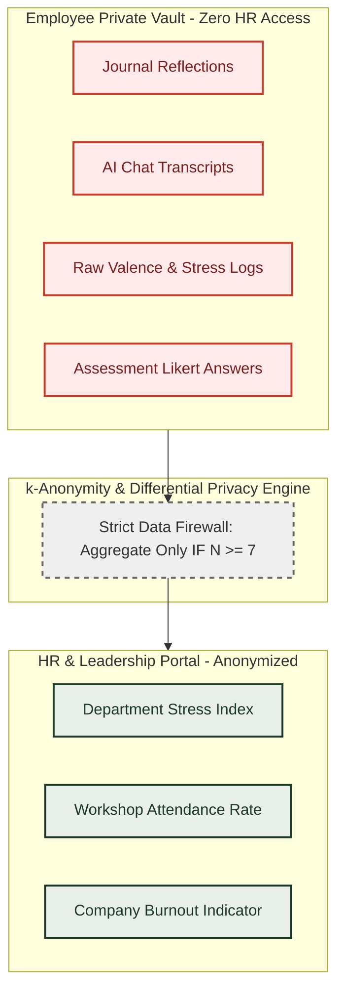

# MindBalance — Non-Functional Requirements Specification
**Document Code:** NFRS-MB-V1.0  
**Target:** Performance, Reliability, Privacy, Accessibility, and Security Engineering

---

## 1. Performance & Latency Targets

| Metric | Target SLA | Measurement Method & Tooling |
|---|---|---|
| **API Response Time (CRUD)** | $\le 120\text{ ms}$ (p50), $\le 250\text{ ms}$ (p95) | Express.js middleware logging + Supertest latency tests |
| **Complex Aggregations (HR Pulse)** | $\le 400\text{ ms}$ (p95) | Firebase Cloud Firestore Explain Plans & execution time tracking |
| **First Contentful Paint (FCP)** | $\le 1.2\text{ s}$ | Lighthouse / Chrome DevTools Performance Audit |
| **Largest Contentful Paint (LCP)** | $\le 2.0\text{ s}$ | Next.js Server Components optimization & image compression |
| **Cumulative Layout Shift (CLS)** | $\le 0.05$ | Explicit dimensions on cards, charts, and media |
| **Interactive Animation Frame Rate** | Constant $60\text{ FPS}$ | Framer Motion hardware-accelerated transforms (GPU) |
| **Client Bundle Size (Initial Load)** | $\le 180\text{ KB}$ gzipped | Next.js dynamic imports (`React.lazy`) and tree-shaking |

---

## 2. Scalability & Workload Capacity

- **Concurrent Active Users**: Architected to support up to 5,000 active enterprise employees with horizontal container replication.
- **Database Throughput**:
  - Daily check-in peak burst: 500 writes/sec during morning 9:00 AM - 10:30 AM arrival window.
  - Mitigated via compound indexing on `{ userId: 1, date: -1 }` and connection pool sizing ($PoolSize = 50$).
- **Stateless Application Tier**: Express.js API designed as a stateless node allowing seamless scaling across multi-container instances behind an NGINX or cloud load balancer.
- **Session Architecture**: Scalable signed Firebase ID tokens with server-side Redis or encrypted Firebase Cloud Firestore session storage (`Firebase Auth`).

---

## 3. Reliability, Resilience & Graceful Degradation

- **Availability Target**: $99.9\%$ operational uptime for core platform services.
- **AI Service Resilience (Circuit Breaker & Fallback)**:
  - External LLM API calls are bounded by a strict 4.5-second timeout.
  - If the external AI service returns 5xx or times out, the backend gracefully falls back to a curated local reflection engine containing 50+ deterministic, evidence-based cognitive reframing prompts.
  - The user interface notifies the employee: *"MindBalance Reflection is currently running in offline supportive mode."*
- **Database Failover**: Leveraging Firebase Cloud Firestore automated 3-node replica sets with zero-data-loss failover.
- **Graceful Client Error Boundaries**: React Error Boundaries wrap each independent widget (e.g., Recharts analytics, Audio player, Breathwork visualizer) so a single module failure never crashes the full dashboard.

---

## 4. Privacy Engineering & Data Confidentiality

MindBalance adheres to the strictest ethical privacy boundaries modeled after GDPR (Article 9 for Special Category Health Data) and workplace privacy protections:



### Privacy Guarantees:
1. **The $k$-Anonymity Rule ($k=7$)**: Any organizational query slicing data by department, tenure, or team will suppress results if fewer than 7 unique respondents have logged data in that window.
2. **Zero Text Aggregation**: Journal reflections, private notes, and AI conversational prompts are strictly **never** included in any administrative report or aggregation pipeline.
3. **Voluntary Participation**: All stress assessments and daily check-ins are explicitly voluntary; system does not penalize or notify managers if an employee skips check-ins.
4. **Data Sovereignty & Right to Erasure**: Employees can delete their historical mood telemetry or AI conversation history at any time with a single-click purge.

---

## 5. Security & Threat Mitigation

MindBalance implements defense-in-depth mitigations against the OWASP Top 10 vulnerabilities:

- **Authentication & Credential Protection**:
  - Passwords hashed using `bcrypt` (12 rounds) with individual salts.
  - Protection against credential stuffing with IP and account-level rate limiting (5 failed attempts locks for 15 minutes).
- **Session Security**:
  - `httpOnly`: Protects against client-side XSS stealing Firebase ID tokens.
  - `secure`: Transmitted exclusively over TLS 1.3 / HTTPS.
  - `sameSite: "strict"`: Shields against Cross-Site Request Forgery (CSRF).
- **Injection Defenses**:
  - Firebase Cloud Firestore input sanitization (`Zod validation plus Firestore-safe input sanitization`) to prevent malformed query payloads and unsafe Firestore access patterns (e.g., `$gt`, `$ne`).
  - Strict input validation schemas via `Zod` prior to service processing.
- **API Security Headers**:
  - Integrated `helmet` middleware configuring `Content-Security-Policy`, `X-Frame-Options: DENY`, `X-Content-Type-Options: nosniff`.
- **Environment Isolation**:
  - Zero hardcoded secrets; validated on startup with a strict environment variable schema (process aborts if `SESSION_SECRET` or `FIREBASE_PROJECT_ID`, `FIREBASE_CLIENT_EMAIL`, and `FIREBASE_PRIVATE_KEY` are missing).

---

## 6. Accessibility & Human Factors (WCAG 2.1 AA)

- **Contrast Ratios**: All text elements achieve a minimum contrast ratio of $4.5:1$ against backgrounds (Forest Green `#1B382B` on Warm Ivory `#FAF8F5` achieves $> 10:1$).
- **Keyboard Navigability**: All interactive controls (breathwork buttons, mood sliders, game cards, dialogs) are fully operable via Tab, Space, and Arrow keys with distinct visual focus rings.
- **Screen Reader Support**: Full ARIA roles, live regions (`aria-live="polite"` for breathwork timers and counter changes), and semantic HTML5 hierarchy.
- **Reduced Motion Support**:
  ```css
  @media (prefers-reduced-motion: reduce) {
    *, ::before, ::after {
      animation-duration: 0.01ms !important;
      transition-duration: 0.01ms !important;
    }
  }
  ```
  Users with vestibular disorders can disable breathing circle expansion and spring animations.

---

## 7. Usability & Cognitive Load Minimization

- **Calming Visual Harmony**: Absence of flashing lights, high-intensity neon alerts, or panic-inducing red warning badges.
- **Low-Effort Interactions**: Daily check-in requires fewer than 3 taps/clicks and takes under 30 seconds to complete.
- **Micro-Intervention Efficacy**: Mind Relief Zone tools (breathwork, memory game) default to 2-3 minute micro-sessions suited for quick transitions between meetings.

---

## 8. Compliance & Ethical Guardrails

- **Explicit Non-Clinical Disclaimer**: Visible in the application footer, assessment headers, and AI assistant dialog:
  > *"MindBalance is an educational and supportive workplace well-being platform. It is not a healthcare provider and does not provide clinical diagnoses, psychiatric treatment, or medical prescriptions. If you are experiencing an acute mental health crisis, please consult a medical professional or contact 988 immediately."*
- **Zero Employment Retaliation Policy**: System license and architectural constraints forbid utilizing employee well-being data in performance evaluations, layoffs, or compensation reviews.
