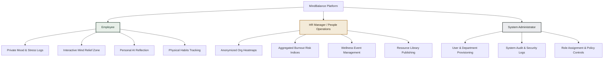

# MindBalance — Project Overview
**Intelligent Workforce Well-being and Stress Management System**  
*B.Tech Computer Science & Engineering — Final-Year Major Project*

---

## 1. Executive Summary

In fast-paced enterprise environments, chronic workplace stress, cognitive fatigue, and impending burnout are leading drivers of employee disengagement, absenteeism, and attrition. Traditional corporate wellness initiatives often fail due to three critical roadblocks:
1. **Intrusiveness & Privacy Anxiety**: Employees fear their mental health data or vulnerability may be exposed to HR or used against them in appraisals.
2. **Clinical Stigmatization**: Heavy clinical diagnostic framing alienates individuals looking for everyday micro-interventions.
3. **Passive & Fragmented Tooling**: Static HR portals with generic PDF self-care tips lack engaging, real-time stress relief tools and actionable feedback loops.

**MindBalance** is an intelligent, privacy-first, enterprise-grade full-stack platform designed to systematically counter these challenges. It bridges personal micro-interventions (breathwork, mood telemetry, cognitive reframing, ergonomics) with anonymized, privacy-preserving organizational insights that empower leadership to cultivate healthier work environments without ever violating individual confidentiality.

---

## 2. Academic Context & Project Vision

As a B.Tech CSE Final-Year Capstone Project, MindBalance integrates key computing disciplines:
- **Software Architecture**: Decoupled, production-ready frontend (Next.js/React/TypeScript) and backend micro-monolith (Node.js/Express.js/TypeScript).
- **Data Engineering**: Schema-enforced NoSQL modeling (Firebase Cloud Firestore) with server-side aggregation logic for real-time statistical synthesis.
- **Privacy Engineering**: Implementation of $k$-anonymity thresholds ($N \ge 7$) and role-based cryptographic isolation to guarantee data sovereignty.
- **Applied Human-Computer Interaction (HCI)**: Cognitive-load-minimizing UI/UX, bio-inspired micro-animations (Framer Motion), accessible visualization (Recharts), and mindful design aesthetics.
- **Applied Artificial Intelligence**: Context-aware, safety-filtered conversational reflection with strict non-clinical boundaries, automated triage, and crisis fallback handling.

---

## 3. Core Modules Inventory

| # | Module | Scope & Capability |
|---|---|---|
| **01** | **Authentication & RBAC** | Secure session management, bcrypt/argon2 hashing, role-based guards (`Employee`, `HR_Manager`, `Admin`), Firebase ID tokens and server-side auth checks. |
| **02** | **Employee Wellness Dashboard** | Centralized personal cockpit featuring daily check-in streaks, stress telemetry trends, personalized intervention suggestions, and quick-relief triggers. |
| **03** | **Mood & Stress Self-Assessment** | Daily affective valence tracking (energy vs. pleasantness), standardized Perceived Stress Scale (PSS-4), and WHO-5 Well-Being Index check-ins with contextual notes. |
| **04** | **Mind Relief Zone** | Interactive visual breathwork (Box Breathing, 4-7-8), ambient acoustic soundscapes, micro-break cognitive exercises (Memory Matrix), and Pomodoro focus challenges. |
| **05** | **Physical Wellness Tracking** | Ergonomic posture alerts, customizable hydration logging, screen-time break enforcement, and desk stretch step-by-step guides. |
| **06** | **AI Wellness Assistant** | Non-clinical, empathetic reflection companion with cognitive reframing prompts, strict safety filters, and immediate crisis helpline triage triggers. |
| **07** | **Activities, Events & Resources** | Enterprise wellness workshop calendar, RSVP tracking, curated stress management articles, audio guides, and organizational wellness challenges. |
| **08** | **HR & Administrator Dashboards** | Anonymized departmental stress heatmaps, burnout vulnerability indexes, aggregate program participation metrics, and audit management. |
| **09** | **Notifications & Reminders** | Configurable, non-intrusive in-app and browser notifications for hydration, posture checks, mindfulness breaks, and assessment reminders. |
| **10** | **Analytics & Reporting** | Real-time multi-dimensional trend analytics (Recharts), cohort comparisons, and downloadable executive summary reports. |
| **11** | **Backend APIs & Data Management** | Fully typed Express.js REST API with Zod validation, rate limiting, Firestore data collections, and sanitized query pipelines. |
| **12** | **Security, Testing & DevOps** | OWASP Top 10 mitigations, strict privacy perimeter, Vitest/Supertest automated unit/integration suites, Playwright E2E testing, and containerized deployment. |

---

## 4. Key Stakeholder Personas

### 4.1. The Enterprise Employee (e.g., Software Engineer, Sales Exec)
- **Goal**: Decompress during high-pressure work sprints, log stress levels without fear of surveillance, access micro-interventions in under 3 minutes.
- **Pain Point**: Skeptical of corporate "wellness monitoring"; demands absolute assurance that managers cannot inspect personal notes or AI dialogues.

### 4.2. The HR / People Operations Leader
- **Goal**: Detect high-stress patterns across departments (e.g., Engineering vs. Customer Support) before attrition spikes; measure ROI of wellness workshops.
- **Pain Point**: Needs actionable systemic data without encroaching on ethical boundaries or legal liabilities.

### 4.3. The System Administrator
- **Goal**: Maintain enterprise tenant stability, enforce role-based segregation, monitor access logs, configure security parameters, and manage accounts.

---

## 5. Scope & Strict Non-Goals

### In-Scope (Committed Deliverables)
- Enterprise-ready responsive web application (Next.js + Express.js).
- Full role-based isolation with complete privacy firewalls.
- Engaging, interactive client-side stress-reduction tools (canvas/SVG breathwork, audio, interactive games).
- Statistical aggregation engine enforcing minimum departmental sample sizes ($k$-anonymity).
- Robust automated test suite covering unit, integration, and end-to-end user journeys.

### Out-of-Scope (Strict Non-Goals)
- **Medical/Psychiatric Diagnosis**: MindBalance is explicitly **not** a Diagnostic and Statistical Manual (DSM-5) diagnostic tool or medical device.
- **Performance Evaluation / Ranking**: Never will wellness data be utilized to score, rank, promote, or discipline employees.
- **Direct Therapist Video Telehealth**: Tele-therapy sessions require specialized HIPAA/EHR compliance; MindBalance provides curated emergency contacts and institutional referral links instead.
- **Biometric Hardware Scraping**: No direct smart-watch Bluetooth/hardware sensor integration in Phase 1 (manual logging and browser-level activity prompts only).

---

## 6. Success Metrics & Demonstration Benchmarks

For the academic defense and live viva demonstration, success is evaluated against:
1. **Zero Data Leakage**: Verifiable test confirming that HR cannot query individual journal logs, AI chats, or raw check-ins via any API endpoint.
2. **Sub-200ms API Latency**: Express endpoints respond within 200ms on p95 under standard load.
3. **Flawless UI Fidelity**: Consistent Warm Ivory & Forest Green design language without generic templates or unstyled states.
4. **Resilient AI Safety Triage**: Triggering high-distress keyword detection immediately surfaces national crisis hotlines with supportive, non-clinical messaging.
