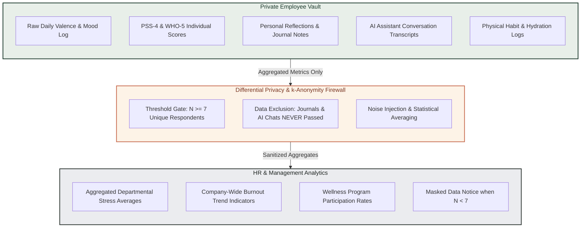
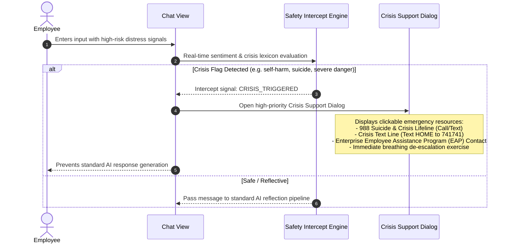

# MindBalance — Security & Privacy Architecture Plan
**Document Code:** SEC-MB-V1.0  
**Compliance Standards:** Modeled after GDPR (Article 9 Special Category Protections), OWASP ASVS v4.0, and Workplace Confidentiality Norms

---

## 1. Ethical Foundations & The "Privacy Vault"

Mental health and well-being data is among the most sensitive personal information an employee can generate. If employees suspect that their vulnerabilities, burnout symptoms, or private reflections might be observed by managers, HR, or used in performance evaluations, the system ceases to be a supportive haven and becomes a surveillance tool.

MindBalance addresses this via an unbreachable architectural boundary termed the **"Privacy Vault"**:



---

## 2. Privacy Guarantees & Constraints

### 2.1. The $k$-Anonymity Principle ($k=7$)
- **Constraint**: No organizational report, departmental breakdown, or cohort analysis may display metrics computed from a sample size smaller than 7 distinct employees ($N < 7$).
- **Enforcement**: Built directly into the database aggregation pipeline. If $N < 7$, the backend returns:
  ```json
  {
    "isMasked": true,
    "maskReason": "Sample size below privacy threshold (N < 7). Individual data is protected."
  }
  ```
  Numerical averages are replaced with `null` so no inference attacks can be conducted.

### 2.2. Zero Qualitative Aggregation
- **Constraint**: Employee journal notes, private thoughts, and AI conversation messages are strictly **never indexed, aggregated, or displayed** in any HR dashboard.
- **Enforcement**: The HR analytics pipeline queries only the `MoodEntry` fields `stressLevel` and `valence`. The field `privateJournalEncrypted` is excluded at the Firestore query layer and never returned in aggregated HR views..

### 2.3. Right to Complete Erasure
- **Constraint**: In accordance with privacy sovereignty, any employee can purge their entire mental health history at any time without deleting their company user account.
- **Enforcement**: An Firestore batched write deletes all mood logs, assessments, and AI dialogues for that `userId` upon request.

---

## 3. Non-Clinical Medical Disclaimer & Safety Governance

MindBalance is strictly a self-care and workforce stress-management application. It is **not** a diagnostic medical tool, psychiatric treatment platform, or clinical healthcare device.

### 3.1. Standard Disclaimer Language
The following banner is persistently rendered across assessment screens, AI assistant interactions, and the application footer:
> **Medical & Clinical Disclaimer**:  
> *"MindBalance provides educational resources, self-guided stress management tools, and habit tracking for general workforce wellness. It is not a clinical healthcare service, medical device, or substitute for professional psychiatric diagnosis or psychological therapy. If you are experiencing severe emotional distress, suicidal thoughts, or a medical crisis, please seek immediate professional medical attention or call the 988 Suicide & Crisis Lifeline."*

### 3.2. Automated Crisis Intercept & Triage Protocol


---

## 4. Authentication, Session Security & Credential Protection

### 4.1. Password Hashing
- Algorithm: `bcrypt` with a minimum cost factor of 12 rounds, or `argon2id` (memory-hard, resistant to GPU attacks).
- Salts: Generated uniquely per password via cryptographically secure pseudo-random number generator (CSPRNG).
- Plaintext passwords are never logged, serialized, or stored in any cache or error trace.

### 4.2. Secure Session Management
- **Token Mechanism**: Cryptographically signed Firebase ID tokens stored server-side in Firebase Cloud Firestore (`Firebase Auth`).
- **Cookie Security Attributes**:
  - `HttpOnly`: Prevents JavaScript on the client (e.g., via XSS) from reading session tokens.
  - `Secure`: Transmitted solely over TLS 1.3 / HTTPS connections.
  - `SameSite=Strict`: Protects against Cross-Site Request Forgery (CSRF).
  - `Max-Age=604800`: 7-day expiration with sliding window on active use.
- **Session Revocation**:
  - Explicit logout invalidates the user auth state in Firebase Cloud Firestore immediately.
  - Password change or security reset invalidates all concurrent sessions for that user account.

---

## 5. Input Validation, Sanitization & Threat Protection

### 5.1. NoSQL Injection Prevention
- All user-supplied inputs pass through `Zod validation plus Firestore-safe input sanitization` to strip any keys beginning with `$` or containing `.`.
- Strictly typed Zod schemas validate data types before values touch Firebase Admin SDK + Firestore queries.

### 5.2. Cross-Site Scripting (XSS) Defenses
- React's default DOM escaping automatically neutralizes script tags in UI rendering.
- Markdown rendering in resource articles is parsed using `react-markdown` with `rehype-sanitize` enforcing a strict HTML whitelist.

### 5.3. Rate Limiting Policy
Configured via `express-rate-limit` using IP and session keys:
- **Authentication Routes (`/api/v1/auth/*`)**: 10 requests / 15 minutes per IP.
- **AI Chat Routes (`/api/v1/ai/*`)**: 15 requests / 15 minutes per session.
- **General API Routes**: 150 requests / 15 minutes per session.

---

## 6. Secrets Management & Environment Configuration

### 6.1. Zero Secrets in Source Control
- All sensitive credentials (`FIREBASE_PROJECT_ID`, `FIREBASE_CLIENT_EMAIL`, `FIREBASE_PRIVATE_KEY`, `SESSION_SECRET`, and `AI_API_KEY`) reside exclusively in local `.env` files (whitelisted in `.gitignore`).
- A strict startup validator (`env.ts`) halts application boot if any mandatory environment variable is absent or malformed.

```typescript
// backend/config/env.ts
import { z } from 'zod';

const EnvSchema = z.object({
  NODE_ENV: z.enum(['development', 'test', 'production']).default('development'),
  PORT: z.string().default('5000').transform((val) => parseInt(val, 10)),
  CLIENT_ORIGIN: z.string().default('http://localhost:3000'),
  FIREBASE_PROJECT_ID: z.string().min(1),
  FIREBASE_CLIENT_EMAIL: z.string().email(),
  FIREBASE_PRIVATE_KEY: z.string().min(1),
  SESSION_SECRET: z.string().min(32, 'Session secret must be at least 32 characters'),
  AI_API_KEY: z.string().optional().default(''),
  AI_PROVIDER: z.enum(['google', 'openai']).default('google')
});

export const env = EnvSchema.parse(process.env);
```

---

## 7. Audit Logging & Non-Punitive Employment Policy

### 7.1. Audit Logging Standards
- All administrative actions (user provisioning, role modifications, event publications, policy adjustments) are recorded in the `AuditLog` collection.
- Logs capture: `timestamp`, `actorId`, `actorRole`, `actionType`, `targetResource`, `ipAddress`.
- Audit logs **never** capture employee wellness data, journal contents, or check-in scores.

### 7.2. Non-Punitive Workplace Guarantee
MindBalance’s enterprise license explicitly binds deploying organizations to ethical workplace standards:
1. Wellness data may **never** be used in employee performance evaluations, compensation reviews, or promotion decisions.
2. Wellness participation is 100% voluntary; zero negative flags are generated for non-participation.
3. HR dashboards provide macro-level organizational health telemetry only, fostering proactive environmental improvements (e.g., meeting-free Fridays, workload balancing) rather than individual scrutiny.
