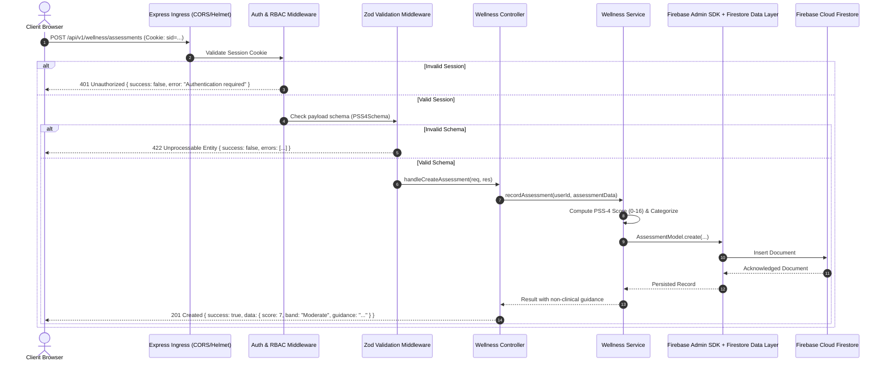
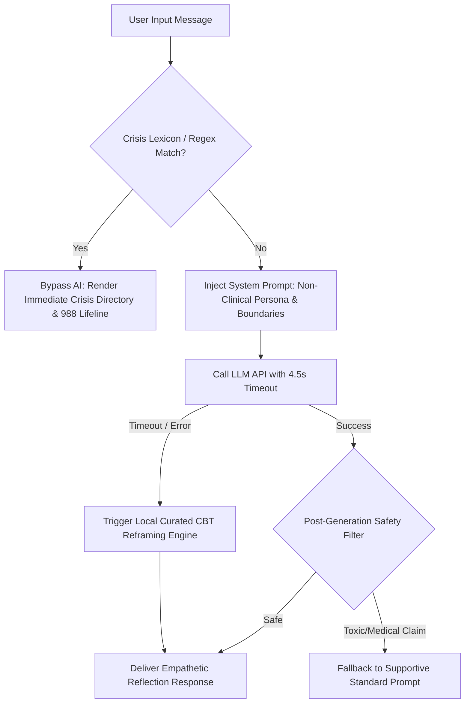
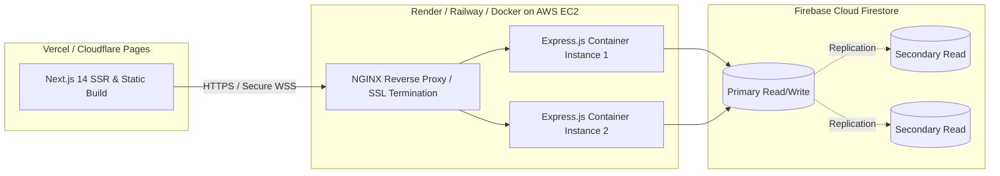

# MindBalance — System Architecture Specification
**Document Code:** ARCH-MB-V1.0  
**Pattern:** Decoupled Multi-Tier Architecture with Modular Service Layer

---

## 1. High-Level Architectural Pattern

MindBalance adopts a modern **Decoupled Multi-Tier Architecture**, cleanly segregating the Presentation Tier (Next.js client) from the Application & Domain Logic Tier (Express.js REST API) and the Persistence Tier (Firebase Cloud Firestore).

```mermaid
graph TB
    subgraph Client_Tier [Presentation Tier - Next.js 14+ / React]
        UI[shadcn/ui + Tailwind CSS]
        State[React Context / TanStack Query]
        Animation[Framer Motion & Web Audio Engine]
        Viz[Recharts Data Visualizations]
        SW[Service Worker - Web Push]
    end

    subgraph Edge_Security [Edge & Ingress Gateway]
        CORS[CORS Policy & Credentials]
        RateLimit[Express Rate Limiter]
        SecurityHeaders[Helmet CSP / HSTS]
        CookieParser[Firebase ID Token Verification Middleware]
    end

    subgraph API_Tier [Application Tier - Express.js / TypeScript]
        Router[API Route Ingress /api/v1]
        ZodValidator[Zod Schema Validation Middleware]
        AuthGuard[Session & RBAC Middleware]
        
        subgraph Domain_Services [Modular Domain Services]
            AuthService[Auth & User Service]
            WellnessService[Wellness & Assessment Service]
            ReliefService[Mind Relief & Audio Service]
            AIService[AI Reflection & Safety Engine]
            AnalyticsService[Privacy-Preserving Aggregations]
            NotificationService[Scheduler & Notification Service]
        end
    end

    subgraph Persistence_Tier [Data & Persistence Tier]
        FirestoreODM[Firestore ODM / Validation Layer]
        Firebase Cloud Firestore[(Firebase Cloud Firestore Replica Set)]
        FirebaseAuth[(Firebase Auth Session Store)]
    end

    subgraph External_Integrations [External Services]
        LLMProvider[AI API Provider: OpenAI / Gemini API]
        LocalFallback[Deterministic Reflection Fallback Engine]
        CrisisHotline[Crisis Lifeline Dispatch Directory]
    end

    Client_Tier -->|HTTPS / REST + Secure Cookies| Edge_Security
    Edge_Security --> Router
    Router --> ZodValidator
    ZodValidator --> AuthGuard
    AuthGuard --> Domain_Services
    
    AuthService --> Firebase Admin SDK + FirestoreODM
    WellnessService --> Firebase Admin SDK + FirestoreODM
    ReliefService --> Firebase Admin SDK + FirestoreODM
    AnalyticsService --> Firebase Admin SDK + FirestoreODM
    NotificationService --> Firebase Admin SDK + FirestoreODM
    
    AIService -->|Timeout <= 4.5s| LLMProvider
    AIService -. Fallback on Timeout/Error .-> LocalFallback
    AIService -. High-Risk Trigger .-> CrisisHotline

    Firebase Admin SDK + FirestoreODM --> Firebase Cloud Firestore
    AuthGuard --> FirebaseAuth
    FirebaseAuth --> Firebase Cloud Firestore
```

---

## 2. Layered Responsibilities & Separation of Concerns

### 2.1. Presentation Layer (Next.js / React / TypeScript)
- **Role**: Render responsive, accessible views, handle client-side route transitions, execute fluid animations (Framer Motion), draw interactive charts (Recharts), and manage local audio playback.
- **State Management**: Server state synchronized via TanStack Query (React Query) for smart caching, optimistic UI updates, and automatic cache invalidation; local UI state managed via modern React Context and Hooks.
- **Zero Business Rule Leakage**: Does not perform sensitive calculations or aggregate data locally; all business rules and privacy thresholds are authoritative on the server.

### 2.2. Edge & Security Ingress Layer
- **CORS Config**: Strictly whitelist trusted origin (e.g., `http://localhost:3000` in dev, production frontend domain in prod) with `credentials: true`.
- **Helmet**: Injects security headers (`X-Content-Type-Options`, `X-Frame-Options: DENY`, `Strict-Transport-Security`).
- **Rate Limiting**: Granular IP/Session limits:
  - Auth routes (`/api/v1/auth/*`): 10 reqs / 15 mins.
  - AI chat routes (`/api/v1/ai/*`): 15 reqs / 15 mins.
  - General API: 150 reqs / 15 mins.

### 2.3. Application & Service Layer (Node.js / Express / TypeScript)
- **Modular Controller-Service-Repository Pattern**:
  - `Controllers`: Parse requests, trigger validation, delegate to services, format standard JSON response envelopes.
  - `Services`: Encapsulate core business logic (score computation, streak calculation, privacy thresholds, safety filtering).
  - `Repositories / Models`: Handle Firebase Admin SDK + Firestore queries, lean projections, and Firestore query pipelines.
- **Middleware Pipeline**:
  ```
  Request -> Helmet -> CORS -> CookieParser -> SessionValidator -> 
  RateLimiter -> ZodValidator -> RBACGuard -> Controller -> Service -> Response Envelope
  ```

### 2.4. Data & Persistence Layer (Firebase Cloud Firestore)
- **Multi-Document ACID Transactions**: Used when user creation requires atomic initialization of profile and default preferences.
- **Optimized Compound Indexes**: Accelerate time-series queries on mood logs and assessment histories.
- **Aggregation Pipelines**: Execute $k$-anonymity queries directly in the database engine, returning only aggregated averages, standard deviations, and cohort counts to Node.js memory.

---

## 3. End-to-End Request-Response Lifecycle



---

## 4. Subsystem Breakdown

### 4.1. Privacy-Preserving Analytics Subsystem
The HR Analytics subsystem is architecturally isolated from individual records:
1. HR requests departmental metrics via `/api/v1/admin/analytics/department?dept=Engineering`.
2. Service invokes a Firestore query layer with a filtered aggregation pattern using user and department indexes:
   - Stage 1 (`$group` by `userId`): Counts distinct active respondents ($N$).
   - Stage 2 (`$match`): Evaluates $N \ge 7$. If $N < 7$, pipeline short-circuits and outputs `masked: true`.
   - Stage 3 (`$group` overall): Computes average stress index and participation percentage without exposing individual user IDs or timestamps.

### 4.2. Mind Relief Multimedia Engine
- **Client-Side Synthesis**: Interactive visual breathwork uses vector SVG and CSS/Framer Motion transforms. No video streaming required, preserving low network overhead.
- **Audio Soundscapes**: Compressed WebM/MP3 audio loops preloaded and cached via the browser Cache API. Supports zero-latency continuous playback with Web Audio API crossfading.
- **Offline Resilient Storage**: Exercise instructions and mini-game states are cached via Progressive Web App (PWA) manifest and Service Worker.

### 4.3. AI Wellness Assistant with Guardrail Architecture


---

## 5. Deployment & Runtime Topology



- **Environment Separation**: Distinct `.env.development`, `.env.test`, and `.env.production` profiles.
- **Health Checks**: Dedicated endpoint `/api/v1/health` verifying database connectivity, Firebase Auth status, and memory consumption.
