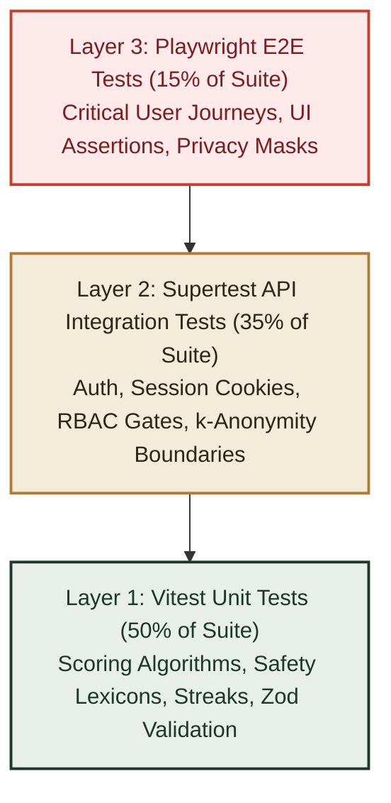
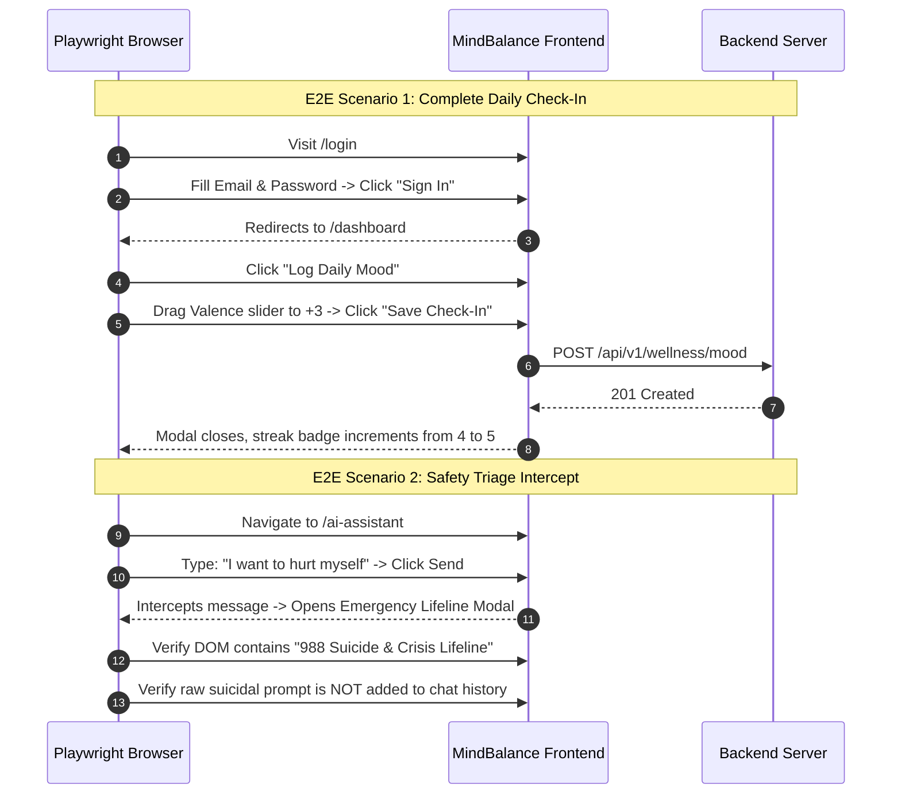

# MindBalance — Quality Assurance & Testing Strategy
**Document Code:** QAT-MB-V1.0  
**Testing Frameworks:** Vitest (Unit & Scoring), Supertest (API Integration), Playwright (E2E User Journeys)  
**Target Code Coverage:** $\ge 80\%$ Line & Branch Coverage

---

## 1. Testing Pyramid & Verification Philosophy

MindBalance employs a rigorous, multi-tiered testing strategy ensuring that every layer of the application—from isolated scoring math to cross-network privacy boundaries—is verified prior to deployment.



---

## 2. Unit Testing Specification (Vitest)

Unit tests focus on pure domain logic, deterministic calculation engines, and safety filters without external database dependencies.

### 2.1. Test Suites & Assertions

| Test Suite File | Tested Component | Core Assertions & Edge Cases |
|---|---|---|
| `pss4.test.ts` | PSS-4 Score Engine | Normalizes raw scores (0-16); handles reversed scoring on questions 2 and 3; correctly bands into Low (0-5), Moderate (6-10), and High (11-16). |
| `who5.test.ts` | WHO-5 Well-Being Index | Sums scores (0-25) and multiplies by 4 for 0-100% scale; flags score $\le 50$ as indicative of low vitality. |
| `streak.test.ts` | Streak Computation | Handles same-day duplicates, consecutive day increments, missing a day (streak resets to 1), and UTC midnight rollover. |
| `safetyFilter.test.ts` | AI Crisis Lexicon Engine | Detects high-risk phrases (e.g., "kill myself", "end it all", "self-harm") with regex fuzzy matching; ignores benign phrases like "this deadline is killing me" (context awareness). |
| `zodSchemas.test.ts` | Payload Schemas | Rejects invalid valence ($<-5$ or $>5$), negative water intake, unformatted emails, and weak passwords. |

### 2.2. Example Unit Test: PSS-4 Scoring
```typescript
import { describe, it, expect } from 'vitest';
import { calculatePSS4Score } from '../../backend/services/assessmentScoring';

describe('PSS-4 Assessment Scoring Engine', () => {
  it('correctly inverts positive questions (Q2 and Q3) and calculates total', () => {
    // Q1 (negative): 3 (often) -> 3
    // Q2 (positive): 2 (sometimes) -> inverted: 4 - 2 = 2
    // Q3 (positive): 3 (fairly often) -> inverted: 4 - 3 = 1
    // Q4 (negative): 3 (often) -> 3
    // Total: 3 + 2 + 1 + 3 = 9
    const answers = [3, 2, 3, 3];
    const result = calculatePSS4Score(answers);
    
    expect(result.rawScore).toBe(9);
    expect(result.severityBand).toBe('MODERATE');
    expect(result.normalizedScore).toBeCloseTo((9 / 16) * 100);
  });

  it('rejects answers outside the 0-4 range', () => {
    expect(() => calculatePSS4Score([5, 1, 2, 0])).toThrowError(/Invalid answer value/);
  });
});
```

---

## 3. API Integration Testing Specification (Supertest)

Integration tests spin up an in-memory Firebase Cloud Firestore instance (`Firebase Emulator Suite / Firestore emulator`) to test Express controllers, Firebase Admin SDK + Firestore models, and security middleware in a realistic environment.

### 3.1. Critical Integration Test Cases

1. **Firebase Auth & Token Lifecycle**:
   - `POST /api/v1/auth/login` sets signed `mb_session` cookie with `HttpOnly` and `SameSite=Strict`.
   - Subsequent authenticated requests pass cookie and receive `200 OK`.
   - `POST /api/v1/auth/logout` invalidates session in Firebase Cloud Firestore Firebase Auth; subsequent requests receive `401 Unauthorized`.

2. **Role-Based Access Control (RBAC)**:
   - Request to `/api/v1/admin/analytics/department` with an `EMPLOYEE` session returns `403 Forbidden`.
   - Request to `/api/v1/admin/analytics/department` with an `HR_MANAGER` session returns `200 OK`.
   - Unauthenticated request returns `401 Unauthorized`.

3. **$k$-Anonymity Privacy Guarantee Verification**:
   - Seed department "Marketing" with 4 users ($N=4 < 7$).
   - Execute `GET /api/v1/admin/analytics/department?dept=Marketing`.
   - Assert response body:
     ```json
     {
       "isMasked": true,
       "averageStressLevel": null,
       "sampleSize": 4
     }
     ```
   - Seed 4 additional users ($N=8 \ge 7$).
   - Execute query again; assert `isMasked: false` and numerical averages are returned.

4. **Insecure Direct Object Reference (IDOR) Protection**:
   - User A attempts `DELETE /api/v1/wellness/mood/:id` for a record belonging to User B.
   - Assert response returns `404 Not Found` or `403 Forbidden`, preventing unauthorized data manipulation.

---

## 4. End-to-End Testing Specification (Playwright)

Playwright tests execute in headless Chromium and Firefox browsers, testing actual DOM interactions, animations, and visual states.

### 4.1. Core E2E Scenarios



---

## 5. Security & Penetration Testing Criteria

Prior to capstone submission, the platform is audited against common attack vectors:

- **NoSQL Injection**: Submitting payloads like `{"email": {"$gt": ""}, "password": "any"}` to `/api/v1/auth/login` must be rejected by `Zod` validation and `Zod validation plus Firestore-safe sanitization`.
- **Cross-Site Scripting (XSS)**: Submitting `<script>alert(1)</script>` in journal reflections must be safely encoded by React DOM and sanitized on the backend.
- **CSRF Defense**: Verifying that cross-origin `fetch` requests without explicit CORS headers and credentials cannot execute state-changing POST/DELETE requests.
- **Rate-Limiting Verification**: Firing 20 consecutive login requests in 5 seconds triggers `429 Too Many Requests`.

---

## 6. Test Automation CI Pipeline

```yaml
# GitHub Actions Workflow: .github/workflows/ci.yml
name: MindBalance Continuous Integration
on: [push, pull_request]

jobs:
  test:
    runs-on: ubuntu-latest
    steps:
      - uses: actions/checkout@v4
      - uses: actions/setup-node@v4
        with:
          node-version: 20
          cache: 'npm'
      - name: Install Dependencies
        run: npm ci
      - name: Run Linter & Typecheck
        run: |
          npm run lint
          npm run typecheck
      - name: Run Unit & Integration Tests (Vitest)
        run: npm run test:coverage
      - name: Run Playwright E2E Tests
        run: |
          npx playwright install --with-deps
          npm run test:e2e
```
