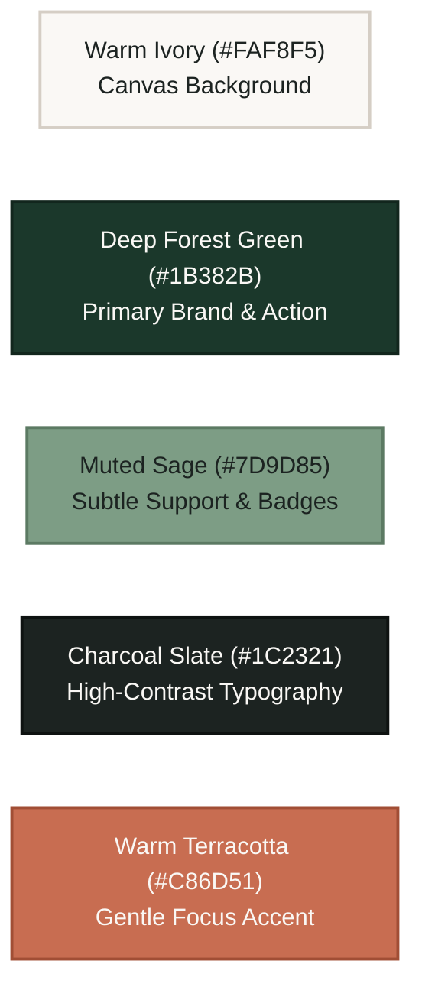

# MindBalance — UI/UX Design System & Experience Guidelines
**Document Code:** UIX-MB-V1.0  
**Design Philosophy:** *"A Warm Sanctuary for Modern Work"* — Calm, Dignified, Organic, and Non-Intrusive

---

## 1. Brand Identity & Visual Language

Most enterprise software looks clinical, sterile, or overwhelming with bright blue SaaS dashboards, dense data tables, and alarming red notification badges. MindBalance deliberately departs from this paradigm:

- **Warmth & Grounding**: Organic, earth-inspired tones that lower cortisol levels rather than provoke alertness.
- **Dignity & Discretion**: Interfaces that feel personal, peaceful, and respectful of psychological safety.
- **Clarity Over Clutter**: Generous whitespace, purposeful hierarchy, and maximum three primary focal elements per view.
- **Tactile Caliber**: Soft micro-shadows, subtle border distinctions (`border-stone-200/60`), and spring-damped interactions.

---

## 2. Color Palette System & Tokens

MindBalance implements a tailored, WCAG AA compliant palette built around Warm Ivory, Deep Forest Green, Muted Sage, and Charcoal.



### 2.1. Color Tokens & HSL Mapping

| Token Name | Hex Code | HSL Value | Primary Application |
|---|---|---|---|
| `--background` | `#FAF8F5` | `38, 27%, 97%` | Application viewport canvas |
| `--surface-card` | `#FFFFFF` | `0, 0%, 100%` | Elevated widgets, interactive cards |
| `--surface-subtle` | `#F4EFEA` | `33, 29%, 94%` | Inset wells, input backgrounds, table headers |
| `--border-subtle` | `#E8E2D9` | `36, 21%, 88%` | Soft card borders, divider lines |
| `--primary` | `#1B382B` | `151, 35%, 16%` | Primary buttons, active tabs, strong headers |
| `--primary-hover` | `#142C22` | `154, 38%, 12%` | Button hover and pressed states |
| `--primary-light` | `#EBF2ED` | `140, 20%, 93%` | Active pill badges, subtle tint highlights |
| `--secondary-sage` | `#7D9D85` | `135, 14%, 55%` | Secondary metrics, icons, progress fills |
| `--accent-terracotta`| `#C86D51` | `14, 52%, 55%` | Streak badges, gentle callouts, warm accents |
| `--text-primary` | `#1C2321` | `165, 9%, 12%` | Headings, primary body copy ($14.2:1$ contrast) |
| `--text-muted` | `#66706B` | `153, 5%, 42%` | Metadata, timestamps, supporting labels ($5.1:1$) |
| `--status-calm` | `#4B8063` | `147, 26%, 40%` | Low stress indicators, healthy hydration |
| `--status-moderate` | `#B8863A` | `37, 52%, 47%` | Moderate stress indicators, mid check-in |
| `--status-elevated` | `#A85344` | `9, 43%, 46%` | High stress, crisis helpline indicators |

---

## 3. Typography & Hierarchy

MindBalance couples modern sans-serif precision for dense telemetry with a warm, humanist serif for moments of reflection and mindful pause.

- **Primary Interface Font**: `Plus Jakarta Sans` or `Inter` (Geometric humanist sans, exceptional screen legibility at 12px–16px).
- **Reflective Accent Font**: `Fraunces` or `Playfair Display` (Soft editorial serif, used for daily affirmations, breathing prompts, and journal prompts).
- **Monospace Telemetry Font**: `JetBrains Mono` (Tabular numbers for timers, breath countdowns, and hydration volume).

### Hierarchy Scale:
- `Display (Hero)`: `text-3xl font-serif text-charcoal tracking-tight` (32px / 1.2 line-height)
- `Section Header (H1)`: `text-2xl font-sans font-semibold text-charcoal` (24px / 1.3)
- `Card Title (H2)`: `text-lg font-sans font-medium text-charcoal` (18px / 1.4)
- `Body Text`: `text-sm font-sans font-normal text-text-primary leading-relaxed` (14px / 1.6)
- `Caption / Metadata`: `text-xs font-sans font-medium text-text-muted` (12px / 1.5)

---

## 4. Component Design Patterns (shadcn/ui Customization)

### 4.1. Organic Wellness Cards
- **Border**: `1px solid var(--border-subtle)`.
- **Border Radius**: `rounded-2xl` (16px) for a soft, friendly silhouette.
- **Shadow**: `shadow-[0_2px_8px_rgba(28,35,33,0.04)]` — light, natural elevation without heavy dark blur.
- **Padding**: Generous `p-6` or `p-8` spacing ensuring elements have room to breathe.

### 4.2. Mood & Valence Slider
- Discrete stepped slider with magnetic snap points from -5 to +5.
- Color dynamically transitions smoothly across the spectrum:
  - `-5 to -2`: Muted Warm Rose (`#C47A70`)
  - `-1 to +1`: Neutral Soft Sand (`#C2B8A3`)
  - `+2 to +5`: Gentle Sage Green (`#7D9D85`)

### 4.3. Interactive Breathwork Visualizer
- **Visual**: Double concentric SVG circles.
  - Inner circle: Solid Sage Green with gentle radial glow.
  - Outer circle: Thin Forest Green dashed stroke indicating the maximum inhale expansion boundary.
- **Pacing Animation**:
  - `Inhale`: Scale 0.6 -> 1.0 (4 seconds, `easeInOutQuad`)
  - `Hold`: Static 1.0 (4 seconds, subtle micro-pulse)
  - `Exhale`: Scale 1.0 -> 0.6 (4 seconds, `easeInOutQuad`)
  - `Rest`: Static 0.6 (4 seconds)
- **Central Counter**: Large serif number (4... 3... 2... 1...) with live screen reader announcements (`aria-live="polite"`).

---

## 5. Micro-Interactions & Framer Motion Tokens

```typescript
// Shared animation transitions
export const springTransition = {
  type: "spring",
  stiffness: 260,
  damping: 24
};

export const gentleFadeIn = {
  initial: { opacity: 0, y: 8 },
  animate: { opacity: 1, y: 0 },
  exit: { opacity: 0, y: -8 },
  transition: { duration: 0.25, ease: "easeOut" }
};

export const cardHoverEffect = {
  whileHover: { y: -2, transition: { duration: 0.15 } },
  whileTap: { scale: 0.99 }
};
```

---

## 6. Page Layout Wireframes

### 6.1. Employee Wellness Dashboard Layout
```
+-----------------------------------------------------------------------------------+
|  MindBalance Logo      [ Dashboard ]  [ Mind Relief ]  [ Habits ]     (Sarah Chen) |
+-----------------------------------------------------------------------------------+
|                                                                                   |
|  Good morning, Sarah.                               [ 🔥 5-Day Wellness Streak ]  |
|  "Take a mindful moment before jumping into code review."                         |
|                                                                                   |
|  +---------------------------+  +------------------------+  +------------------+  |
|  | Today's State             |  | Hydration Tracker      |  | Mind Relief Zone |  |
|  | [ Balanced - Valence +2 ] |  | [==== 1,250 / 2,000ml ]|  | [ 4-7-8 Breath ] |  |
|  | Stress Level: 4/10        |  | (+250ml)  (+500ml)     |  | [ Memory Game  ] |  |
|  | (Edit Daily Check-In)     |  | Posture Breaks: 3      |  | [ Rain Audio   ] |  |
|  +---------------------------+  +------------------------+  +------------------+  |
|                                                                                   |
|  +--------------------------------------------------+  +-----------------------+  |
|  | 14-Day Stress & Energy Trajectory (Recharts)     |  | AI Reflection Pocket  |  |
|  |                                                  |  | "Notice any recurring |  |
|  |  Stress: ~-~-\_/\_~-                              |  |  pressure today?"    |  |
|  |  Energy: _/---\__/-                              |  |                       |  |
|  |                                                  |  | [ Type a reflection]  |  |
|  +--------------------------------------------------+  +-----------------------+  |
+-----------------------------------------------------------------------------------+
```

### 6.2. HR Organizational Insights Layout ($k \ge 7$ Privacy Guarded)
```
+-----------------------------------------------------------------------------------+
|  MindBalance HR Portal      [ Overview ]  [ Department Heatmap ]  [ Events ] (Admin)|
+-----------------------------------------------------------------------------------+
|                                                                                   |
|  Organizational Well-being Telemetry                  [ Export Executive Report ] |
|  Privacy Standard: k-Anonymity (N >= 7) Active and Enforced                       |
|                                                                                   |
|  +---------------------+  +----------------------+  +---------------------------+ |
|  | Company Stress Index|  | Active Participation |  | Burnout Risk Indicator    | |
|  |      5.2 / 10       |  |      72.4%           |  |         MODERATE          | |
|  |  (-0.4 vs last mo.) |  |  (+6.1% vs last mo.) |  | (Engineering, Ops lead)  | |
|  +---------------------+  +----------------------+  +---------------------------+ |
|                                                                                   |
|  Department Breakdown:                                                            |
|  * Engineering (N=28)    : Stress 5.8/10 | Participation 78% | [ Healthy Trend ]  |
|  * Product & Design(N=12): Stress 4.9/10 | Participation 65% | [ Stable ]         |
|  * Legal & Talent (N=4)  : [ PRIVACY PROTECTED - Sample size below threshold (N<7)]|
|                                                                                   |
+-----------------------------------------------------------------------------------+
```

---

## 7. Accessibility Checklist (WCAG 2.1 AA)

- [x] Background/foreground contrast exceeding $4.5:1$ on all interactive components.
- [x] Zero relying exclusively on color to convey state (labels accompany mood icons).
- [x] Focus rings clearly styled with Forest Green offset (`focus-visible:ring-2 focus-visible:ring-emerald-700`).
- [x] Native audio controls include mute toggle and volume persistence.
- [x] Interactive mini-game supports full keyboard arrow-key navigation.
